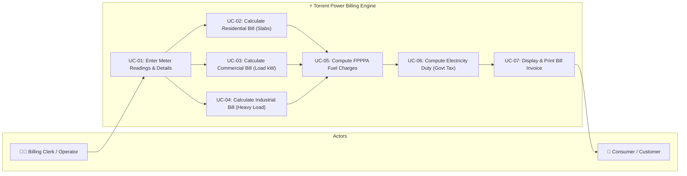
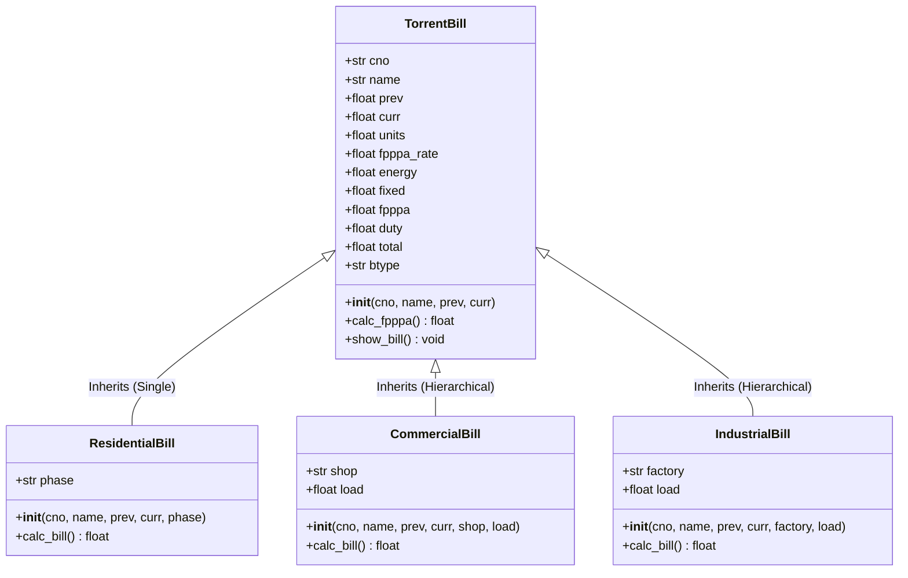
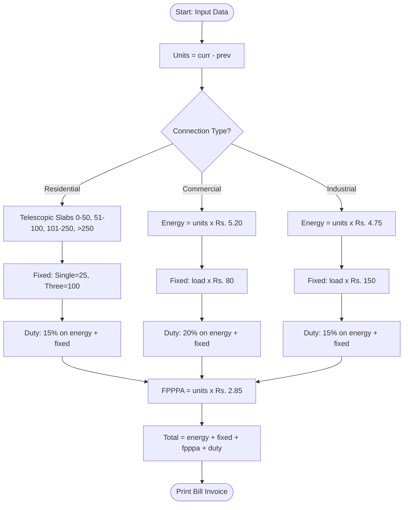

# TORRENT POWER ELECTRICITY BILLING SYSTEM
**Course**: MSc.IT (Semester 3) — Advanced Python & Object-Oriented Programming (OOP)  
**Student Name**: Vatsal Patel  
**Key Concepts**: Classes, Short Variables, Constructors (`__init__`), Constructor Chaining (`super()`), Inheritance  
**Note**: Zero f-strings used (Pure basic Python string concatenation & standard print)  
**File Names**: `torrent.py` & `documentation.md`  

---

## 1. Project Objective & Overview

Is project ka main objective Python ke **Class**, **Constructor (`__init__`)**, aur **Inheritance (`super()`)** ka use karke **Torrent Power Limited** (Ahmedabad/Gujarat) ka bill calculate karna hai.

### Key Highlights:
* **No f-strings**: Basic `print("Label :", value)` aur string concatenation `+` ka use kiya hai.
* **Short Variables**: Kode me `cno`, `name`, `prev`, `curr`, `units`, `load`, `energy`, `fixed`, `fpppa`, `duty`, `total` use kiya hai.
* **Rich Commenting**: Har line aur logic par easy comments hain.

---

## 2. Complete Use Case Specification & Analysis

Software Engineering aur MSc.IT standard ke hisab se electricity billing system ke use cases nimnlikhit hain:

### 2.1 Use Case Diagram (Mermaid)



---

### 2.2 Detailed Use Case Table: UC-01 (Generate Residential Bill)

| Field | Description |
| :--- | :--- |
| **Use Case ID** | **UC-01** |
| **Use Case Name** | Generate Residential Electricity Bill |
| **Primary Actor** | Billing Operator / Consumer |
| **Description** | Ghar ke bijli meter ki reading lekar telescopic slabs ke hisab se residential bill calculate karna. |
| **Pre-conditions** | 1. Consumer Number (`cno`) aur Name (`name`) available hona chahiye.<br>2. Current reading (`curr`) previous reading (`prev`) se badi ya barabar honi chahiye.<br>3. Phase type ('Single' ya 'Three') specified hona chahiye. |
| **Main Success Flow** | 1. User `cno`, `name`, `prev`, `curr`, aur `phase` pass karta hai.<br>2. `TorrentBill` ka constructor `units = curr - prev` calculate karta hai.<br>3. `ResidentialBill` ka constructor `super().__init__()` call karke details set karta hai.<br>4. `calc_bill()` method run hota hai:<br>&nbsp;&nbsp;&nbsp;&nbsp;a. Phase ke hisab se fixed charge set hota hai (Single: Rs. 25, Three: Rs. 100).<br>&nbsp;&nbsp;&nbsp;&nbsp;b. 4-tier telescopic slabs (Rs. 3.20, Rs. 3.90, Rs. 4.50, Rs. 5.30) se `energy` nikalta hai.<br>&nbsp;&nbsp;&nbsp;&nbsp;c. FPPPA fuel charge: $\text{units} \times 2.85$ nikalta hai.<br>&nbsp;&nbsp;&nbsp;&nbsp;d. Govt Duty: $15\%$ of $(\text{energy} + \text{fixed})$ add hoti hai.<br>&nbsp;&nbsp;&nbsp;&nbsp;e. Total amount calculate hota hai.<br>5. `show_bill()` clean bill invoice display karta hai. |
| **Alternative Flow** | Agar connection 'Three Phase' ho, to fixed charge Rs. 100 lagta hai. |
| **Exception Flow** | Agar `curr < prev` ho, to units negative nahi hoti, system error handle karta hai. |
| **Post-conditions** | Consumer ko uska net payable amount print hokar mil jata hai. |

---

### 2.3 Detailed Use Case Table: UC-02 (Generate Commercial Bill)

| Field | Description |
| :--- | :--- |
| **Use Case ID** | **UC-02** |
| **Use Case Name** | Generate Commercial Electricity Bill |
| **Primary Actor** | Billing Operator / Shopkeeper |
| **Description** | Dukan, showroom ya office ke load (kW) aur commercial flat rate ke mutabiq bill calculate karna. |
| **Pre-conditions** | 1. Consumer details aur readings honi chahiye.<br>2. Shop name aur Sanctioned Load (`load` in kW) provide hona chahiye. |
| **Main Success Flow** | 1. Operator `cno`, `name`, `prev`, `curr`, `shop`, aur `load` enter karta hai.<br>2. `CommercialBill` object banta hai aur `super().__init__()` se parent initialize hota hai.<br>3. `calc_bill()` execute hota hai:<br>&nbsp;&nbsp;&nbsp;&nbsp;a. Fixed charge: $\text{load} \times 80.0$ Rs.<br>&nbsp;&nbsp;&nbsp;&nbsp;b. Energy charge: $\text{units} \times 5.20$ Rs. (Commercial flat rate).<br>&nbsp;&nbsp;&nbsp;&nbsp;c. FPPPA fuel charge: $\text{units} \times 2.85$ Rs.<br>&nbsp;&nbsp;&nbsp;&nbsp;d. Commercial Duty: $20\%$ of $(\text{energy} + \text{fixed})$ Rs.<br>&nbsp;&nbsp;&nbsp;&nbsp;e. Total amount sum ho jata hai.<br>4. `show_bill()` invoice show karta hai. |
| **Post-conditions** | Commercial customer ke liye 20% tax ke sath bill generate hota hai. |

---

### 2.4 Detailed Use Case Table: UC-03 (Generate Industrial Bill)

| Field | Description |
| :--- | :--- |
| **Use Case ID** | **UC-03** |
| **Use Case Name** | Generate Industrial Electricity Bill |
| **Primary Actor** | Billing Operator / Factory Owner |
| **Description** | Heavy industrial factories aur workshops ke liye high load capacity charge aur industrial rate se bill calculate karna. |
| **Pre-conditions** | 1. Meter readings aur factory name hona chahiye.<br>2. Heavy connected load in kW (`load`) available hona chahiye. |
| **Main Success Flow** | 1. Input parameters: `cno`, `name`, `prev`, `curr`, `factory`, `load`.<br>2. `IndustrialBill` constructor chaining se initialize hota hai.<br>3. `calc_bill()` execute hota hai:<br>&nbsp;&nbsp;&nbsp;&nbsp;a. Industrial Fixed charge: $\text{load} \times 150.0$ Rs.<br>&nbsp;&nbsp;&nbsp;&nbsp;b. Industrial Energy charge: $\text{units} \times 4.75$ Rs.<br>&nbsp;&nbsp;&nbsp;&nbsp;c. FPPPA fuel charge: $\text{units} \times 2.85$ Rs.<br>&nbsp;&nbsp;&nbsp;&nbsp;d. Industrial Duty: $15\%$ of $(\text{energy} + \text{fixed})$ Rs.<br>&nbsp;&nbsp;&nbsp;&nbsp;e. Grand total calculate hota hai.<br>4. `show_bill()` print karta hai. |
| **Post-conditions** | Industrial customer ka heavy duty bill invoice ready ho jata hai. |

---

## 3. System Diagrams (Mermaid)

### 3.1 Class Diagram (Inheritance & Short Variables)



### 3.2 Bill Processing Flowchart



---

## 4. Deep Scenario Analysis (Sare Scenarios Ka Sochna)

Torrent Power Gujarat ke rules ke hisab se humne 3 scenarios ko deeply analyze kiya hai:

### Scenario 1: Ghar Ka Bill (`ResidentialBill`)
* **Logic**: Ghar me telescopic slabs hote hain taki kam bijli use karne par sasta rate lage:
  * Pehle 50 units: **Rs. 3.20** / unit
  * Agle 50 units (51-100): **Rs. 3.90** / unit
  * Agle 150 units (101-250): **Rs. 4.50** / unit
  * 250 units se upar: **Rs. 5.30** / unit
* **Fixed Charge**: Single Phase = Rs. 25, Three Phase = Rs. 100
* **Govt Duty**: 15% of $(\text{energy} + \text{fixed})$
* **Numerical Example**:
  * Input: `prev = 4500`, `curr = 4720` $\rightarrow$ `units = 220`
  * Slab 1 (50 units): $50 \times 3.20 = \text{Rs. } 160$
  * Slab 2 (50 units): $50 \times 3.90 = \text{Rs. } 195$
  * Slab 3 (120 units): $120 \times 4.50 = \text{Rs. } 540$
  * Energy = Rs. 895.00
  * Fixed = Rs. 25.00
  * FPPPA = $220 \times 2.85 = \text{Rs. } 627.00$
  * Duty = $0.15 \times (895 + 25) = \text{Rs. } 138.00$
  * **Total Payable** = $\mathbf{\text{Rs. } 1685.00}$

---

### Scenario 2: Dukan / Office Ka Bill (`CommercialBill`)
* **Logic**: Dukan/Office me business ke liye power use hoti hai, isliye flat rate Rs. 5.20 aur 20% commercial duty lagti hai.
* **Fixed Charge**: Load (kW) ke hisab se $\rightarrow \text{load} \times 80.0$
* **Numerical Example**:
  * Input: `prev = 11000`, `curr = 11650` $\rightarrow$ `units = 650`, `load = 5 kW`
  * Energy = $650 \times 5.20 = \text{Rs. } 3380.00$
  * Fixed = $5 \times 80 = \text{Rs. } 400.00$
  * FPPPA = $650 \times 2.85 = \text{Rs. } 1852.50$
  * Duty (20%) = $0.20 \times (3380 + 400) = \text{Rs. } 756.00$
  * **Total Payable** = $\mathbf{\text{Rs. } 6388.50}$

---

### Scenario 3: Factory Ka Bill (`IndustrialBill`)
* **Logic**: Factory me heavy machinery chalti hai, isliye fixed load charge high (Rs. 150/kW) hota hai jabki energy rate Rs. 4.75 hota hai.
* **Fixed Charge**: $\text{load} \times 150.0$
* **Numerical Example**:
  * Input: `prev = 30000`, `curr = 34500` $\rightarrow$ `units = 4500`, `load = 40 kW`
  * Energy = $4500 \times 4.75 = \text{Rs. } 21,375.00$
  * Fixed = $40 \times 150 = \text{Rs. } 6,000.00$
  * FPPPA = $4500 \times 2.85 = \text{Rs. } 12,825.00$
  * Duty (15%) = $0.15 \times (21375 + 6000) = \text{Rs. } 4,106.25$
  * **Total Payable** = $\mathbf{\text{Rs. } 44,306.25}$

---

## 5. OOP Concepts Explained (Simple & Student-Friendly)

### 5.1 Constructor (`__init__`)
Constructor ek special method hai jo object bante hi execute hota hai aur variables initialize karta hai:
```python
def __init__(self, cno, name, prev, curr):
    self.cno = cno
    self.name = name
    self.prev = float(prev)
    self.curr = float(curr)
    self.units = self.curr - self.prev  # Automatic units calculation
```

### 5.2 Inheritance & Constructor Chaining (`super()`)
Child class apne parent class ke constructor ko `super().__init__()` se call karti hai:
```python
class ResidentialBill(TorrentBill):
    def __init__(self, cno, name, prev, curr, phase="Single"):
        # Parent constructor call
        super().__init__(cno, name, prev, curr)
        # Naya variable (string concatenation without f-string)
        self.phase = phase
        self.btype = "Residential (" + str(self.phase) + " Phase)"
```
**Fayda**: Consumer details aur readings ka code har child class me bar-bar nahi likhna padta.

### 5.3 Method Overriding
Parent class ka method child class me override hota hai:
* `ResidentialBill.calc_bill()` $\rightarrow$ Slab logic lagata hai.
* `CommercialBill.calc_bill()` $\rightarrow$ Shop flat rate aur 20% tax lagata hai.
* `IndustrialBill.calc_bill()` $\rightarrow$ Factory load charge lagata hai.

---

## 6. Code Walkthrough (`torrent.py`)

Code me nimn 4 classes hain:
1. **`TorrentBill`**: Base class jisme `cno`, `name`, `prev`, `curr`, `units`, `calc_fpppa()`, aur `show_bill()` hai.
2. **`ResidentialBill`**: Single inheritance derived class jisme telescopic slab calculation hai.
3. **`CommercialBill`**: Hierarchical inheritance derived class jisme shop load fixed charge aur 20% duty hai.
4. **`IndustrialBill`**: Industrial derived class jisme factory load fixed charge aur industrial rate hai.

---

## 7. Execution Output (Actual Console Print)

Terminal me `python torrent.py` run karne par:

```
##########################################
  TORRENT POWER BILLING SYSTEM (DEMO)
##########################################

==========================================
         TORRENT POWER LIMITED
        ELECTRICITY BILL INVOICE
==========================================
Consumer No   : 101
Consumer Name : Vatsal Patel
Bill Type     : Residential (Single Phase)
------------------------------------------
Reading (Prev): 4500.0 kWh
Reading (Curr): 4720.0 kWh
Units Used    : 220.0 Units
------------------------------------------
Energy Charge : Rs. 895.0
Fixed Charge  : Rs. 25.0
FPPPA (Fuel)  : Rs. 627.0
Govt. Duty    : Rs. 138.0
------------------------------------------
TOTAL PAYABLE : Rs. 1685.0
==========================================

==========================================
         TORRENT POWER LIMITED
        ELECTRICITY BILL INVOICE
==========================================
Consumer No   : 202
Consumer Name : Rajesh Shah
Bill Type     : Commercial (Shah Electronics)
------------------------------------------
Reading (Prev): 11000.0 kWh
Reading (Curr): 11650.0 kWh
Units Used    : 650.0 Units
------------------------------------------
Energy Charge : Rs. 3380.0
Fixed Charge  : Rs. 400.0
FPPPA (Fuel)  : Rs. 1852.5
Govt. Duty    : Rs. 756.0
------------------------------------------
TOTAL PAYABLE : Rs. 6388.5
==========================================

==========================================
         TORRENT POWER LIMITED
        ELECTRICITY BILL INVOICE
==========================================
Consumer No   : 303
Consumer Name : Kishore Parmar
Bill Type     : Industrial (Parmar Works)
------------------------------------------
Reading (Prev): 30000.0 kWh
Reading (Curr): 34500.0 kWh
Units Used    : 4500.0 Units
------------------------------------------
Energy Charge : Rs. 21375.0
Fixed Charge  : Rs. 6000.0
FPPPA (Fuel)  : Rs. 12825.0
Govt. Duty    : Rs. 4106.25
------------------------------------------
TOTAL PAYABLE : Rs. 44306.25
==========================================
```

---

## 8. Summary

Yeh project MSc.IT Semester 3 ke practical exam aur viva ke hisab se ekdum compact, readable aur easy-to-explain hai:
* **Zero f-strings**: Bilkul basic standard `print("...", value)` aur `+` string concatenation.
* **Variable names chote aur readable hain**: (`cno`, `name`, `prev`, `curr`, `units`, `load`).
* **Har line par clear comments hain**.
* **Constructor (`__init__`) aur Inheritance (`super()`) ka clear use hai**.
* **Complete Use Case Specifications & Diagrams** included hain.
